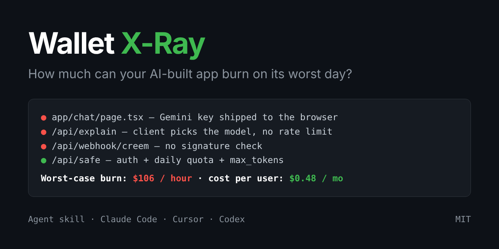

# 💸 Wallet X-Ray



**How much money can your AI-built app burn — on a normal day, and on the worst day?**

A Claude / agent skill that audits your own codebase for *money* holes, not just security holes.
It finds every code path that spends your money (LLM, image, voice, email, SMS, maps, storage),
then gives you three numbers and a fix list.

[中文说明](README.zh-CN.md)

```
🔴 [LLM/gemini]  app/chat/page.tsx:2       (browser) — paid call runs in the browser — key is public
🔴 [LLM/openai]  app/api/explain/route.ts  (server)  — client controls model / max_tokens
🟢 [LLM/anthropic] app/api/safe/route.ts   (server)  — guards found
🔴 NEXT_PUBLIC_GEMINI_API_KEY shipped to the browser
🔴 .env.local tracked by git
🔴 app/api/webhook/creem/route.ts — NO signature check (anyone can fake a payment)

Worst-case burn: $106/hour via POST /api/explain  (≈ $2,547/day)
```

## Why this exists

Security skills ask *"can someone steal my data?"*
The question that actually hurts solo builders is *"can someone run up my bill?"*

- A team's old Google Maps key embedded in their site silently gained Gemini access once they enabled the Gemini API on that project. **$82,314 in 48 hours.** ([The Register](https://theregister.com/2026/03/03/gemini_api_key_82314_dollar_charge/))
- A prototype exported from a sample app used `VITE_*` env vars, so the Gemini key got baked into the public JS bundle. **~$6,000 in 40 minutes.** ([Google AI forum](https://discuss.ai.google.dev/t/6-000-in-unauthorized-gemini-api-charges-from-a-vite-built-client-bundle-requesting-billing-review/142877))

Neither was a "data breach". Both were wallet breaches.

## What you get

| | |
|---|---|
| **1. Cost per active user / month** | light / typical / heavy usage, from the actual prompts in your code |
| **2. Worst-case burn per hour** | max tokens × max requests on your weakest endpoint |
| **3. Margin** | your price − payment fees − AI cost − the free users you subsidize |

Plus:
- 🔴 / 🟡 / 🟢 holes, **sorted by money saved per minute of fixing**
- A **no-code "money firewall" checklist** for today: spend caps, auto-recharge off, key restrictions — only for the providers you actually use
- **Copy-paste fixes** for Next.js + Supabase: move keys server-side, per-user daily quota (one SQL function), `max_tokens`, model allow-list, webhook HMAC verification
- **Live prices** — the skill looks up today's official pricing instead of trusting stale numbers

## Install

**skills CLI (Claude Code, Cursor, Codex, etc.)**
```bash
npx skills add YOUR_GITHUB_NAME/wallet-xray
```

**Claude Code plugin**
```
/plugin marketplace add YOUR_GITHUB_NAME/wallet-xray
/plugin install wallet-xray@wallet-xray
```

**Manual**
```bash
git clone https://github.com/YOUR_GITHUB_NAME/wallet-xray
cp -r wallet-xray/skills/wallet-xray ~/.claude/skills/
```

**Claude.ai** — zip `skills/wallet-xray` and upload it under Settings → Skills.

## Use

In your project, ask:

> "Run a wallet x-ray on this app"
> "Can someone run up my API bill?"
> "How much will this cost me per user?"

Or run the scanner alone (Python 3, no dependencies):

```bash
python3 skills/wallet-xray/scripts/scan.py /path/to/your/app --json wallet-scan.json
```

Try it on the included leaky demo:

```bash
python3 skills/wallet-xray/scripts/scan.py examples/leaky-app
```

## What it checks

- Paid SDK calls: OpenAI, Anthropic, Gemini, OpenRouter, Vercel AI SDK, image gen (Replicate, fal, …), voice, Resend/SendGrid, Twilio, Maps, storage uploads
- Where each call runs (browser vs server) and who can trigger it
- Guards: auth, per-user quota / rate limit, `max_tokens`, input length cap, model fixed server-side
- Fan-out: loops, `Promise.all`, retries, agent loops
- Hard-coded keys (masked in output), secret-looking `NEXT_PUBLIC_` / `VITE_` / `EXPO_PUBLIC_` vars, `.env` files tracked by git
- Payment webhooks without signature verification

## Honest limits

- The scanner is **pattern matching**. It will have false positives and can miss unusual code. The skill tells the agent to open and confirm every finding before reporting — but this is a check-up, not insurance.
- Cost numbers are estimates built on stated assumptions. They're meant to show orders of magnitude (is it $5 or $5,000?), not to replace your provider's billing dashboard.
- This is for auditing **your own** app. Don't point it at other people's systems.

## Contributing

PRs welcome — especially new provider patterns, false-positive reports, and fix recipes for other stacks (Firebase, Django, Rails, Expo).
If you found a real hole with it, opening an issue (without secrets!) helps others learn.

## License

MIT © Pierce He
